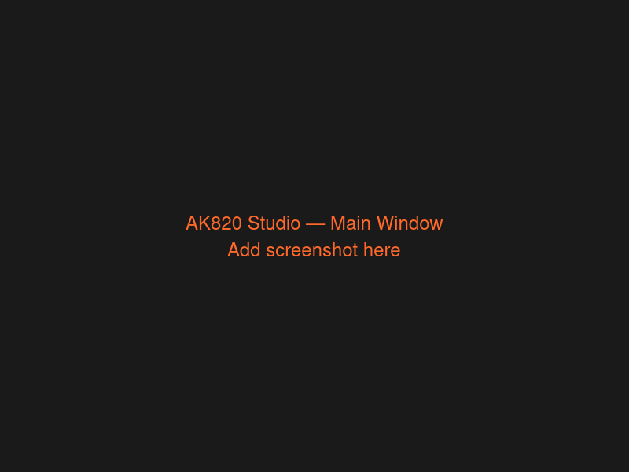
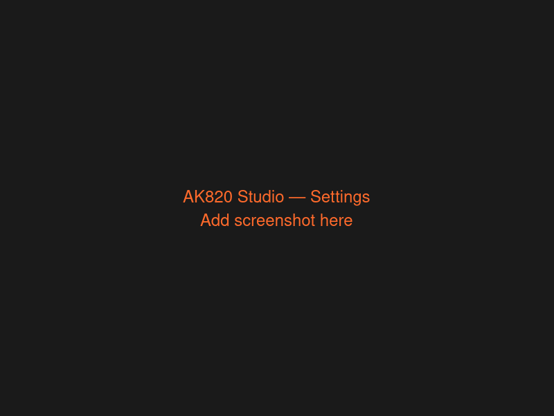
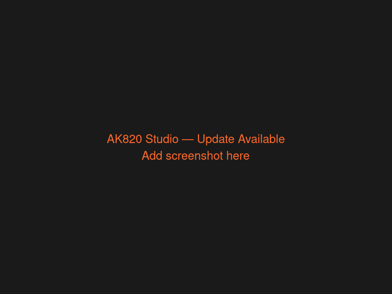

# AK820 Studio

[](https://github.com/WhatTFF/linux-ajazz-ak820-pro-app/actions/workflows/ci.yml)
[](https://github.com/WhatTFF/linux-ajazz-ak820-pro-app/releases)
[](LICENSE)
[](#download)

Native Linux app for the **AJAZZ / Epomaker AK820 Pro** keyboard screen — put GIFs, images, video, text, drawings and procedural animations on the 0.85" 128×128 screen, then forget about it.

A Rust/Tauri rewrite of [fromagge/ak820-screen](https://github.com/fromagge/ak820-screen) with automatic clock sync. Unofficial — not affiliated with AJAZZ or Epomaker.

---

## Screenshots

| Main window | Settings | Update available |
| --- | --- | --- |
|  |  |  |

*Placeholder screenshots in `docs/screenshots/` — replace with real ones from your desktop.*

---

## Download

Prebuilt x86_64 packages are attached to every [release](https://github.com/WhatTFF/linux-ajazz-ak820-pro-app/releases):

[](https://github.com/WhatTFF/linux-ajazz-ak820-pro-app/releases)
[](https://github.com/WhatTFF/linux-ajazz-ak820-pro-app/releases)
[](https://github.com/WhatTFF/linux-ajazz-ak820-pro-app/releases)

| Format | Distros | Install |
| --- | --- | --- |
| `.rpm` | Fedora, RHEL, openSUSE | `sudo dnf install ./ak820-studio-*.rpm` |
| `.deb` | Debian, Ubuntu, Mint, Pop!_OS | `sudo apt install ./ak820-studio_*.deb` |
| `.AppImage` | any glibc distro, no root | `chmod +x ak820-studio_*.AppImage && ./ak820-studio_*.AppImage` |

Every release carries the three packages plus a `SHA256SUMS` file. The app checks for updates itself — you don't have to come back here.

---

## What it does

**Put pictures on your keyboard screen.** Drag and drop images, GIFs or video. Draw, add text, apply effects, adjust colors. Send it to the AK820 Pro's 0.85" 128×128 screen over USB-C.

**Clock stays in sync.** The app pushes your computer's clock to the keyboard on start, on plug-in, and every 12 hours while it runs — so the keyboard's clock never drifts.

**Works over the 2.4 GHz dongle.** Clock sync works over the dongle; pictures need the USB-C cable (the dongle has no screen interface). Designs can always be saved to history and sent later when the keyboard is on the cable.

**Tray-friendly.** Keep it running in the tray, start hidden, sync at login — set it and forget it.

---

## Features

| Feature | Details |
| --- | --- |
| 🖼️ **Images, GIFs, video** | Drag and drop any format; frames are extracted automatically |
| 🎨 **Draw, text, effects** | Built-in canvas, text generator, and procedural animations |
| ⏰ **Clock autosync** | Sync on start, on plug-in, every 12 h, or on demand from the tray |
| 💾 **History** | Every design is saved on disk; restore any previous entry |
| 🗄️ **Tray icon** | Open, sync now, quit — stays out of your way |
| 📦 **In-app updates** | Checks GitHub releases; AppImage replaces itself, RPM/DEB offers a polkit install prompt |
| ⌨️ **ak820ctl CLI** | `info`, `time`, `upload`, `history`, `raw` — everything scriptable |
| 🔒 **Offline-friendly** | No network needed except for update checks and optional GIPHY search |

---

## System requirements

- **Linux x86_64** (Fedora Workstation, Ubuntu 22.04+, Debian, etc.)
- **WebKitGTK 4.1** and **GTK 3** (both ship with Fedora Workstation and Ubuntu 22.04+)
- **udev rule** for hidraw access (installed by the RPM; one-time manual step for DEB/AppImage)

---

## Quick start

**From a package:**

```bash
# Fedora / RHEL
sudo dnf install ./ak820-studio-*.rpm

# Debian / Ubuntu
sudo apt install ./ak820-studio_*.deb

# AppImage
chmod +x ak820-studio_*.AppImage
./ak820-studio_*.AppImage
```

Then flip the keyboard's mode switch to **wired**, plug in the **USB-C cable**, open AK820 Studio, and send your first design.

**From source (Fedora):**

```bash
sudo dnf install gtk3-devel webkit2gtk4.1-devel libsoup3-devel librsvg2-devel openssl-devel \
                 cargo rust gcc gcc-c++ pkgconf-pkg-config
cargo build --release -p ak820-studio -p ak820-cli
sudo install -Dm755 target/release/ak820-studio /usr/local/bin/
sudo install -Dm755 target/release/ak820ctl /usr/local/bin/
sudo install -Dm644 udev/70-ak820.rules /usr/lib/udev/rules.d/70-ak820.rules
sudo udevadm control --reload && sudo udevadm trigger
```

Unplug and replug the keyboard after installing the rule.

---

## Credits

Upstream protocol research, web UI, generators and effects: **fromagge/ak820-screen** (MIT).  
This project vendors that UI and reimplements the transport, storage, autosync and packaging in Rust.  
See [NOTICE](NOTICE) and [docs/UPSTREAM.md](docs/UPSTREAM.md).

---

**Source, issues and releases:** <https://github.com/WhatTFF/linux-ajazz-ak820-pro-app> · [releases](https://github.com/WhatTFF/linux-ajazz-ak820-pro-app/releases) · [issues](https://github.com/WhatTFF/linux-ajazz-ak820-pro-app/issues)